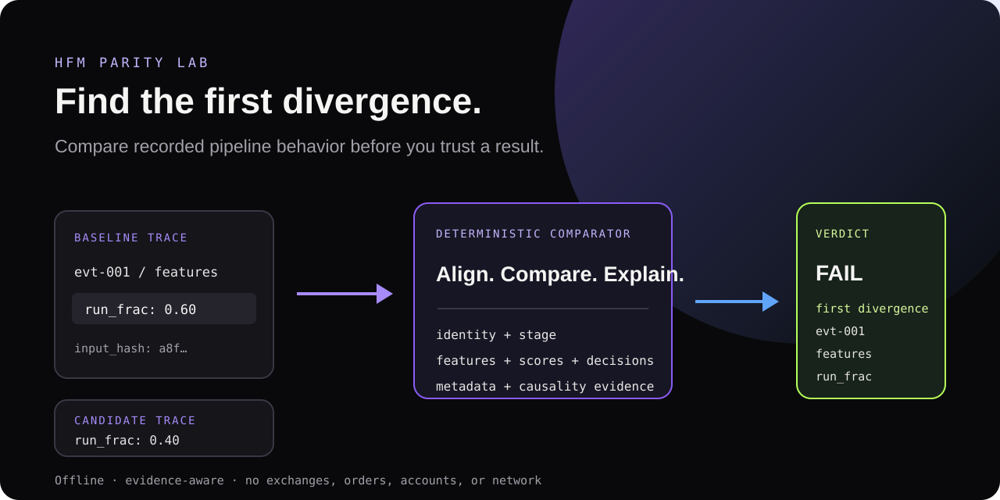

# HFM Parity Lab

<p align="center">
  
</p>

**An open-source Python debugger for investigating differences between backtest, replay and live decision pipelines.**

Record two runs of a pipeline as JSONL, compare them deterministically, and get the
**first observable divergence**: which event, stage and field differed first. Let
Claude Code or Codex do the investigation on top of that evidence through a local,
read-only MCP server and a ready-made agent skill.

It does not find every bug, explain PnL, or say which side is right. It compares
the traces you supply, offline: no exchanges, orders, accounts or network.

```text
# synthetic demo, strict mode
evt-001 · features · run_frac      baseline 0.6   candidate 0.4     <- first divergence
evt-001 · decision                 baseline BUY   candidate HOLD    <- downstream effect
```

## Quick start

Python 3.11+. Not on PyPI yet: install from a source checkout.

```bash
git clone https://github.com/icesurf666/hfm-parity-lab.git && cd hfm-parity-lab
python -m venv .venv && source .venv/bin/activate
```

### 1. Python CLI

```bash
pip install .
hfm-parity demo            # writes parity-demo.html and parity-demo.json (synthetic data)
```

Compare your own traces (exit code `0` PASS, `1` FAIL, `2` not comparable / unverifiable,
`3` invalid input, `4` runtime error; output paths must be relative):

```bash
hfm-parity validate examples/baseline.jsonl
hfm-parity diff --baseline examples/baseline.jsonl --candidate examples/candidate.jsonl \
  --output report.html --json-output report.json
```

### CSV Quick Compare

Have two exported signal logs rather than traces? Use an explicit, reusable column mapping; the CSV adapter
creates internal traces and sends them to the same comparison engine.

```bash
hfm-parity quick-diff examples/csv_quick/backtest.csv examples/csv_quick/live.csv \
  --mapping examples/csv_quick/mapping.json --output report.html --json-output report.json
```

It reports observed feature, score, decision, type, order and event-key differences without asking you to write
JSONL. CSV alone does **not** prove that both pipelines consumed identical market inputs, so matching CSV rows remain
`UNVERIFIABLE` in strict mode unless you supply genuine trace evidence. It does not turn Binance OHLCV, trades or
order-book exports into strategy decisions. See the [Quick Compare tutorial](docs/csv-quick-compare.md).

### 2. Claude Code or Codex

```bash
pip install '.[mcp]'
python examples/synthetic_pipeline/make_demo.py --output-dir demo-traces   # synthetic traces + reports

# Claude Code
claude mcp add --transport stdio hfm-parity -- "$(command -v hfm-parity-mcp)" --root "$PWD/demo-traces"
mkdir -p ~/.claude/skills && cp -R skills/hfm-parity-debug ~/.claude/skills/

# Codex
codex mcp add hfm-parity -- "$(command -v hfm-parity-mcp)" --root "$PWD/demo-traces"
mkdir -p ~/.agents/skills && cp -R skills/hfm-parity-debug ~/.agents/skills/
```

Then ask: *"Backtest and live produce different signals. The traces are in the MCP root;
the code is in `examples/synthetic_pipeline`. Help me find the problem."* The agent validates
and compares the traces, inspects the first divergence, reads the two `run_frac`
implementations, and explains that they compute different quantities under one name.
A real run is recorded in [docs/demo](docs/demo/README.md). Setup details, tool
schemas and security model: [docs/mcp.md](docs/mcp.md). Claude Code was tested end to end;
Codex setup follows its documentation but was not run (see the
[audit](docs/final-release-audit.md)).

### 3. Python SDK

```python
from hfm_parity import RunMeta, TraceRecorder, compare_runs, feature, read_jsonl

def record(path: str, run_id: str, scale: float) -> None:
    meta = RunMeta(run_id, "1.0", "my-app@1", "features@1", "config@1", "unix_epoch_ns", "model@1",
                   data_source="my-feed")
    with TraceRecorder(path, meta) as trace:          # refuses to overwrite an existing file
        trace.record("evt-1", "features", sequence=0, source="feed", event_ts_ns=1,
                     input_hash="abc", decision_ts_ns=2, decision="BUY",
                     features={"imbalance": feature(0.35 * scale, "ratio", available_at_ns=1)})

record("baseline.jsonl", "backtest", 1.0)
record("candidate.jsonl", "live", 0.5)
report = compare_runs(read_jsonl("baseline.jsonl"), read_jsonl("candidate.jsonl"))
print(report.state, report.first_divergence.field, report.deterministic_parity_verified)
# FAIL imbalance False
```

The static React viewer (`web/`; `npm ci && npm run build && npm run preview`) shows a bundled demo report and can open a
report you wrote with `--json-output` through a file picker. It reads the file locally (nothing is uploaded), validates its
shape, renders at most 500 findings, and computes nothing itself.

## What a result means

| Verdict | Meaning |
|---|---|
| `PASS` | No recorded difference. Only in **strict** mode *with complete evidence* is parity *verified* (`deterministic_parity_verified`). |
| `FAIL` | Recorded differences (values, missing/extra/duplicate events, event order). It does not say which side is correct. |
| `NOT_COMPARABLE` | Config, model, schema, declared symbol/venue/data source or input fingerprint differ (strict), or clock domains differ (any mode). |
| `UNVERIFIABLE` | Evidence is missing: no `data_source`, no `input_hash`, no decision timestamps, nothing recorded to compare. Never a pass. |
| `ERROR` | Reserved for boundaries; the CLI exits `3`/`4` instead of emitting a report. |

- **Strict** reproduces one declared run contract. **Regression** compares old vs new on purpose,
  keeps differences visible and *never* sets `deterministic_parity_verified`.
- Events match only by exact `event.id + stage`; record order is part of the contract (events must appear in the same order
  within each stage). No fuzzy time matching, no clock conversion. Integers are compared exactly.
- A verified strict `PASS` needs recorded evidence, not just equal values: `data_source` in the run record and `input_hash`
  on every observation (and `model_version` if you record a `model_score`). Missing evidence gives `UNVERIFIABLE` and the
  report says what to record. See [comparison semantics](docs/comparison-semantics.md).
- `first_divergence` is the earliest recorded difference at an event, in trace order. An earlier
  stage may be uninstrumented, and a later mismatch can be downstream. It is evidence, not a root cause:
  confirming a cause means reading the code (the skill makes the agent do exactly that).
- A comparison says nothing about profitability, and a PASS covers only the supplied records and contracts.

Details: [comparison semantics](docs/comparison-semantics.md), [trace schema](docs/trace-schema.md).

## Documentation

[SDK and CLI](docs/api-cli.md) · [CSV Quick Compare](docs/csv-quick-compare.md) · [MCP and agent skill](docs/mcp.md) · [demo](docs/demo/README.md) ·
[architecture](docs/architecture.md) · [engineering review](docs/engineering-review.md) ·
[performance](docs/performance.md) · [fixture provenance](docs/fixture-provenance.md) ·
[final release audit](docs/final-release-audit.md) · [contributing](CONTRIBUTING.md) · [security](SECURITY.md)

All fixtures, demo traces and reports are synthetic. The repository contains no market data,
models, credentials or private paths. Every handwritten source file is at most 200 lines.

## Development

```bash
pip install -e '.[dev,mcp]'
python -m pytest && ruff check . && mypy src && python tools/check_file_lengths.py
```

## License

MIT. See [LICENSE](LICENSE).
